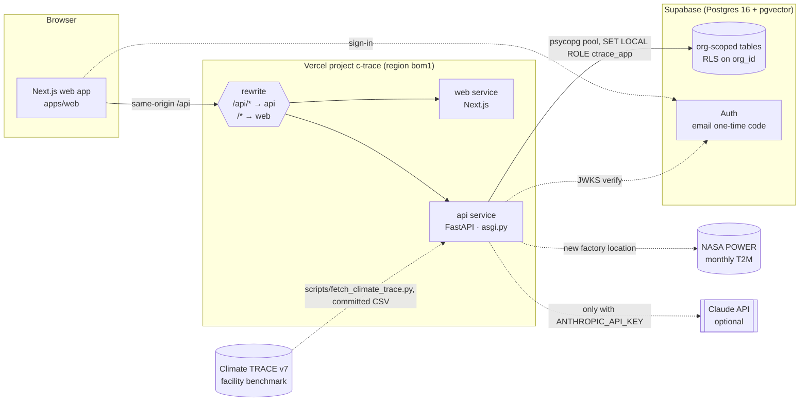
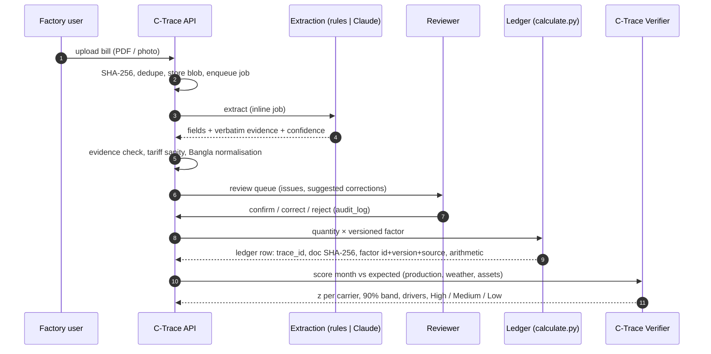

# C-Trace architecture

C-Trace turns a factory's utility bills and fuel receipts into a carbon ledger that a brand, a bank or a regulator can check
line by line. The design follows one rule: **AI reads and explains; deterministic code calculates.** No model output is
ever an emissions number.

## System

- The browser only calls same-origin `/api/...`, so there is no CORS and no API URL in the frontend bundle.
- The same FastAPI app runs locally (`make api`, embedded Postgres), in Docker (`infra/docker-compose.yml`) and on Vercel.
  Only environment variables differ ([docs/plans/phase-10.md](plans/phase-10.md)).
- Without an Anthropic key, C-Trace runs fully offline: rule-based extraction, template narratives and an intent-based
  Copilot. With a key, Claude reads photos and scanned or Bangla bills and writes narratives. Both paths go through the same
  checks.

## From a bill to a verified tonne

Every ledger row can be followed back to the exact document bytes (SHA-256), the factor version and its published source,
and the arithmetic that produced it. Changing a factor creates a new version and writes `audit_log`; existing rows keep
the version they were computed with.

## The C-Trace Verifier (models/ctrace-verifier/v2)

| Piece | What it does | Why |
|---|---|---|
| Expected use | HistGradientBoosting on log1p energy per carrier, from production, workers, processes, assets, NASA POWER cooling degree days, season | What the factory *should* have used |
| Monotonic solar | More rooftop solar can never raise expected grid use | The driver waterfall exposed a non-physical response (D53) |
| Self-calibration | Per-carrier regimes split at interventions that affect that carrier | One factory's own history sets its typical level (D54) |
| Scale σ(x) | Quantile GBM on out-of-fold residuals × a per-type multiplier calibrated to a fixed clean-month Low rate | Large and small factories get equal false-flag rates (fairness rule, ≤ 1.5×) |
| 90% band | Split-conformal on factories never seen in training | "Expected" is shown as a range, not a line |
| Drivers | Exact group Shapley (production, weather, solar, season) relative to the factory's typical month | A reviewer sees *why* a month is high |
| Drift | Spread of recent z-scores vs training | Alerts when the model stops fitting the fleet |

Held-out results, fairness table and limitations are in [models/MODEL_CARD.md](../models/MODEL_CARD.md), which is generated
by `ml/train.py`. CI retrains it and fails if the headline metrics don't reproduce.

## Proven reductions

`ctrace.reduction` fits an IPMVP Option C-style baseline (energy on pieces and CDD) on the months before an intervention
and projects it over the reporting months. A saving is **verified** only if the baseline passes ASHRAE Guideline 14
monthly limits (CV(RMSE) ≤ 15%, |NMBE| ≤ 5%, R² ≥ 0.75, ≥ 12 baseline months) *and* the 90% interval's lower bound is
above zero. A reviewer signs it, which writes `audit_log` and enables the certificate PDF.

## Trust boundaries

| Boundary | Control |
|---|---|
| Organisation data | Every store function runs inside `org_tx`: `SET LOCAL ROLE ctrace_app` plus `ctrace.org_id`, with row-level security on every org table. User requests never bypass RLS. |
| Auth | Supabase JWTs verified against JWKS (`aud=authenticated`, issuer pinned). Demo tokens use a separate issuer and key, and are accepted only for orgs marked `is_demo`. |
| Roles | owner, manager, reviewer, viewer, buyer, lender. Buyers and lenders see reports, not raw bills. |
| LLM text | Every narrative or Copilot answer passes `number_guard`: any figure not present in the verified facts is rejected and the template is used instead. LLM prompts are versioned files. |
| Share links | Random 256-bit token, only its SHA-256 stored; expiring (≤ 90 days), revocable; every view logged with a hashed client. |
| Demo sandbox | Fictional factory, private per visitor, auto-expires; rate-limited per IP; invitations disabled. |
| Uploads | Deduplicated by SHA-256; personal data redacted before any LLM call; size-capped. |

## Repository map

| Path | Role |
|---|---|
| `packages/ctrace/ctrace/` | Core: extraction, factors, calculate, verify, reduction, report, rag, copilot |
| `packages/ctrace/ctrace/store/` | Postgres layer: migrations runner, `org_tx`, jobs, service, verification, reductions, reports, demo |
| `infra/supabase/migrations/` | SQL schema, applied in order and never edited once applied |
| `services/api/ctrace_api/` | FastAPI `/v1` (OpenAPI at http://localhost:8000/docs with `make api`) |
| `services/worker/` | Job runner for self-hosted deployments (Vercel runs jobs inline) |
| `apps/web/` | Next.js 15 web app (dashboard, trace, upload, review, verify, reductions, reports, Copilot, settings) |
| `apps/demo-streamlit/` | Offline fallback UI for the hackathon |
| `ml/` | Verifier training, model card, extraction evaluation |
| `asgi.py`, `vercel.json` | Vercel entrypoint and Services config |
